# Afinity - Yet Another Jellyfin Client

<div align="center">
  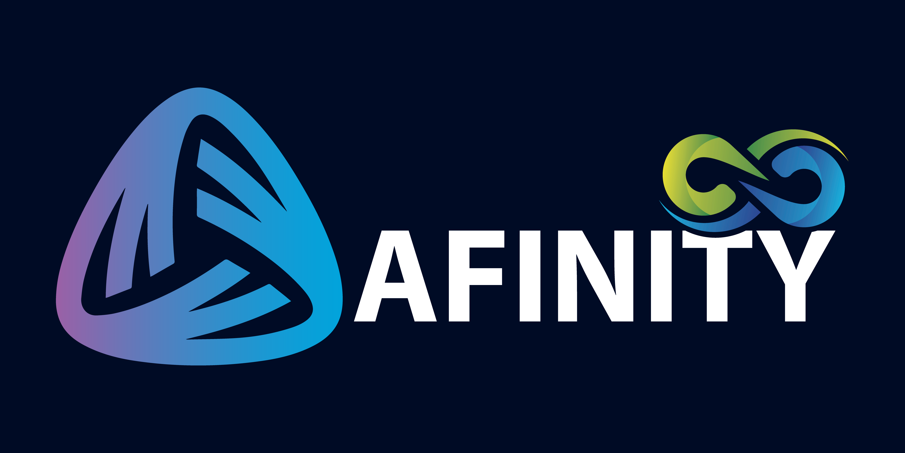

  <a href="https://trendshift.io/repositories/20682?utm_source=trendshift-badge&amp;utm_medium=badge&amp;utm_campaign=badge-trendshift-20682" target="_blank" rel="noopener noreferrer"></a>

[![Release](https://img.shields.io/github/v/release/MakD/AFinity?style=for-the-badge&logo=&labelColor=000000&color=41A67E)](https://github.com/MakD/AFinity/releases)

[](https://github.com/MakD/AFinity/stargazers)
[](https://github.com/MakD/AFinity/releases)
[](https://github.com/MakD/AFinity/blob/master/LICENSE.md)
<a href="https://discord.com/channels/1381737066366242896/1422939582533730325"></a>

[Download](#installation) • [Highlights](#highlights) • [Report Bug](https://github.com/MakD/AFinity/issues) • [Request Feature](https://github.com/MakD/AFinity/issues)

</div>

## Overview

AFinity is a native Android client for Jellyfin. It plays your movies, shows, music and live TV, and goes past playback: it can request new titles through Seerr, play audiobooks and podcasts from Audiobookshelf, show ratings and awards from outside sources, find missing subtitles, and run your Jellyfin server from your phone.

Everything beyond Jellyfin is optional and switched on per server and profile under **Settings > Connect Services**.

> [!IMPORTANT]
> **Requires Jellyfin 12.0 or newer and Android 15 or newer.** On Jellyfin 10.x, stay on [v0.10.10-beta](https://github.com/MakD/AFinity/releases/tag/v0.10.10-beta) until you upgrade.

## Highlights

### A home screen you build yourself

Reorder, hide and add rows, or build your own from a library, genre, studio, collection, playlist or filter. Seasonal rows appear only within their date window. Ready-made rows include:

- **Universes & Sagas**: your movies and shows grouped into franchises, such as every Marvel or Star Wars title you own (needs Wikidata turned on).
- **All-Time Greats** and **Legendary Series**: the IMDb Top 250 movies and series in your library, in ranked order.
- **Popular Right Now** and **What Everyone's Bingeing**: titles trending worldwide that you already have.
- Watch Again, Because You Liked, highest rated, popular studios, and a Spotlight carousel with five content modes and three styles.

<p align="center">
  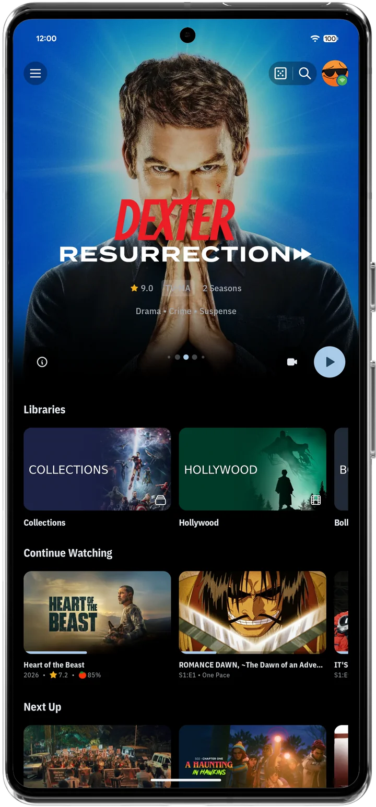
  &nbsp;
  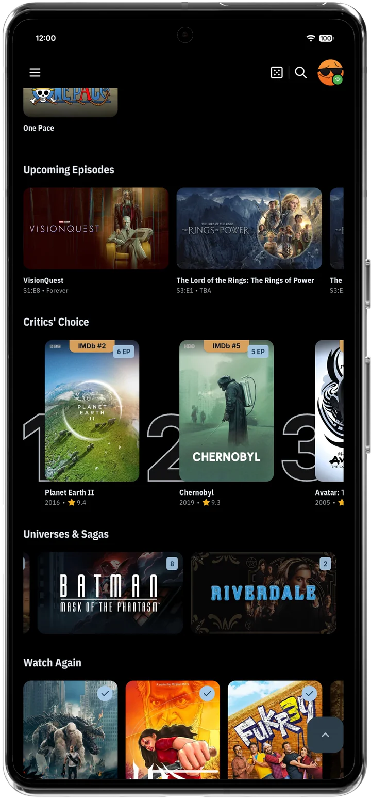
  &nbsp;
  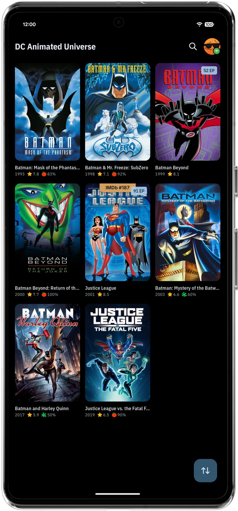
</p>

### Two players: MPV and ExoPlayer

Switch between LibMPV and ExoPlayer. MPV supports Vulkan with HDR passthrough (experimental), and both render ASS/SSA subtitles natively. Both players support:

- Trickplay previews and chapters.
- Skip buttons for intros, outros, recaps, previews and commercials, with countdown, cancel and undo.
- Custom seek steps, a sleep timer, picture-in-picture, keyboard shortcuts and SyncPlay.
- Streaming quality you can change mid-video, with the reason it's transcoding.

Chromecast gets AFinity's own remote for video, music and audiobooks.

<p align="center">
  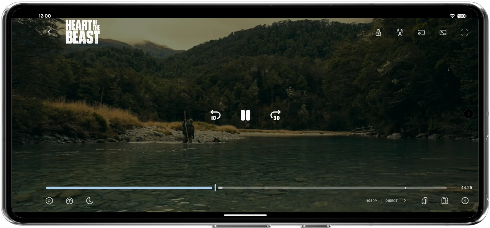
  &nbsp;
  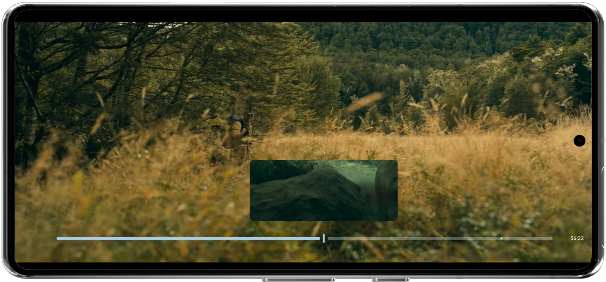
</p>

### Subtitles found for you

No subtitle in your language? Choose **Search online** in the player's subtitle menu. Results come from your server's subtitle plugins and from **TheSubtitleDB** (free, no account), tagged for hearing-impaired and AI-generated tracks. If your account can manage subtitles, the one you pick is saved to the server for every Jellyfin app; otherwise it's kept on the device.

<p align="center">
  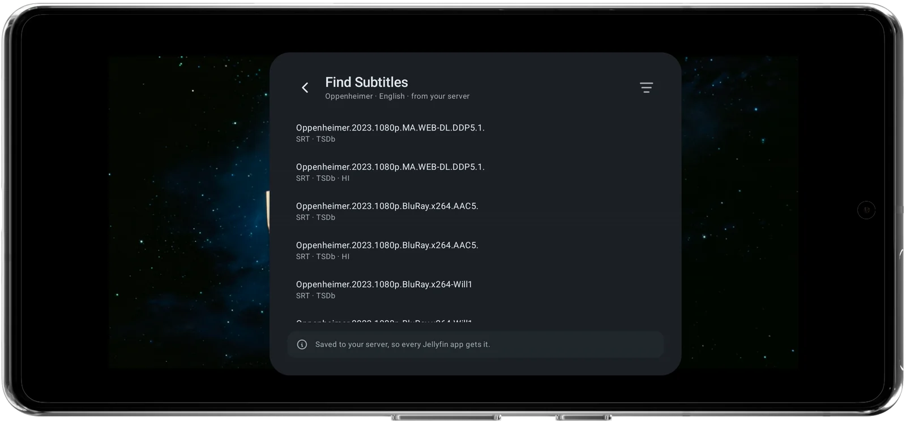
</p>

### Ratings, awards and where to watch

Item pages show IMDb, Rotten Tomatoes (with Certified Fresh and Verified Hot), Metacritic, Letterboxd and TMDB scores. They also show:

- Critic reviews.
- Award wins and nominations for films, shows and people from Wikidata, plus an awards summary from OMDb.
- Which services stream, rent or sell the title in your region.

"Starring...", "More in..." and **Not in your library** rows show what's missing from a collection or a person's filmography. Connect Seerr and you can request those titles straight from the row.

<p align="center">
  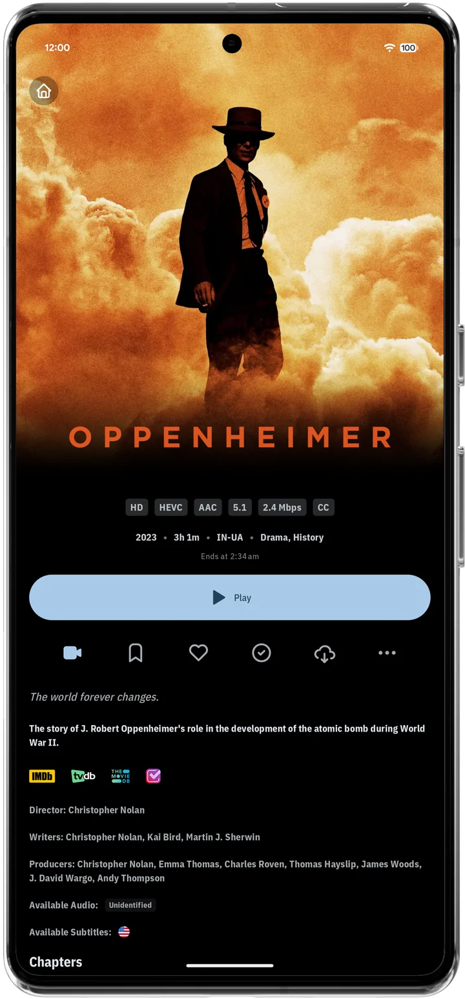
  &nbsp;
  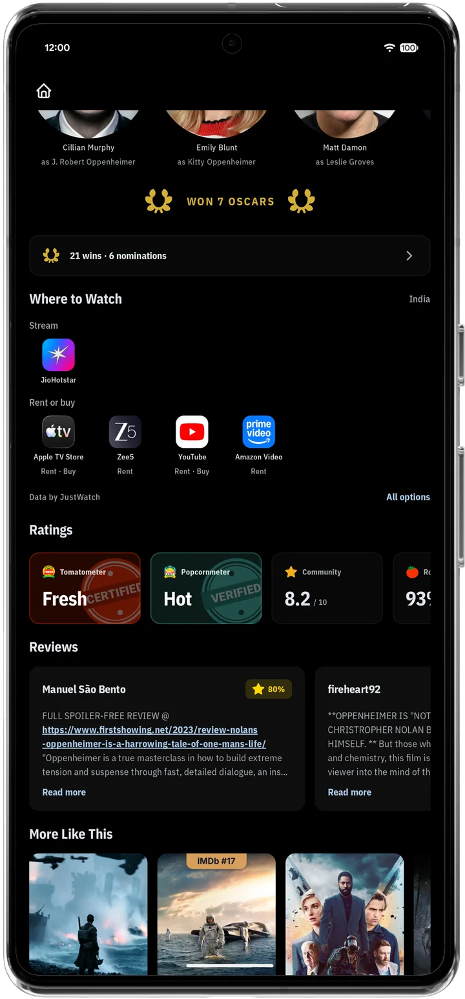
  &nbsp;
  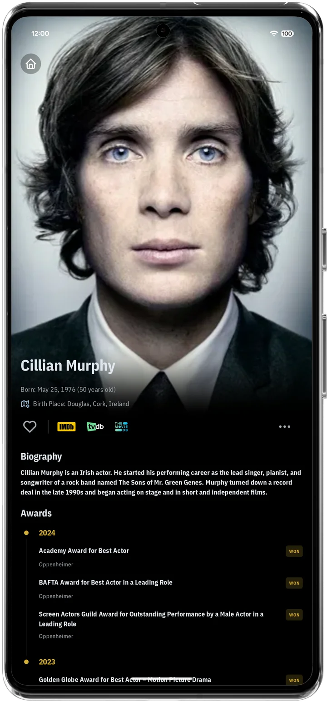
  &nbsp;
  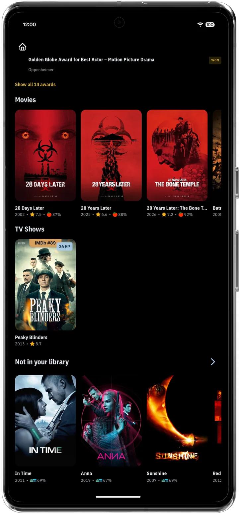
</p>

### Music that goes further

The music player has:

- Word-by-word karaoke lyrics.
- Popular tracks ranked by **Last.fm** listeners.
- Radio and Instant Mix.
- Normalization gain and an equalizer.
- Separate Album Artists and Artists views.

A resizable home screen widget controls music, audiobooks and podcasts, with a Continue listening list. Playback resumes from Bluetooth headphones and from Android's media resume card.

<p align="center">
  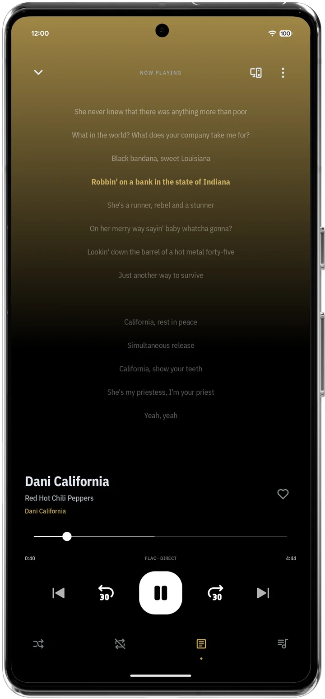
  &nbsp;
  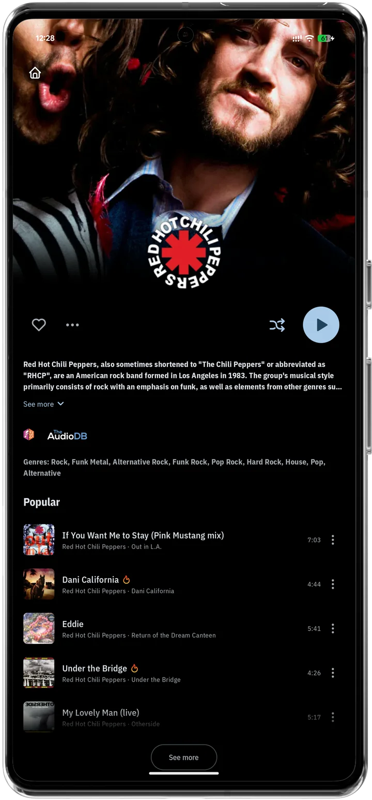
  &nbsp;
  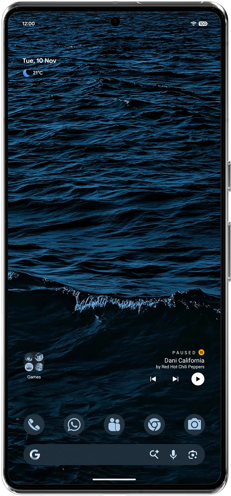
</p>

### Requests through Seerr

With Seerr you can:

- Discover trending, popular and upcoming titles.
- Request movies and shows, including 4K and specials, with season, quality profile and root folder choices.
- Approve, decline or edit requests if your Seerr account is allowed to.
- Keep a watchlist that syncs both ways with Seerr's own watchlist.

Seerr results also show up in the app's search.

<p align="center">
  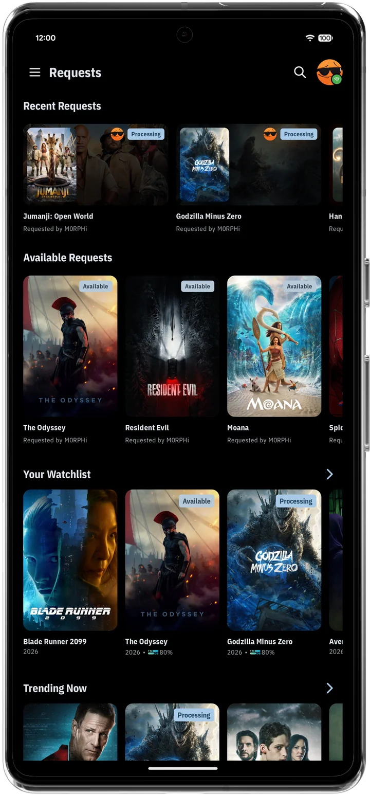
  &nbsp;
  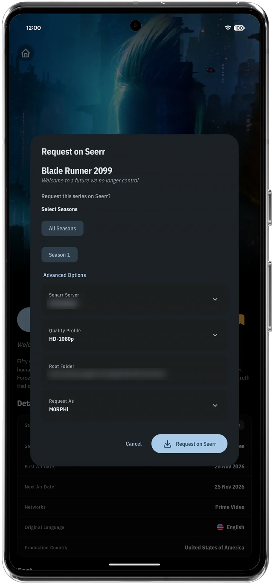
  &nbsp;
  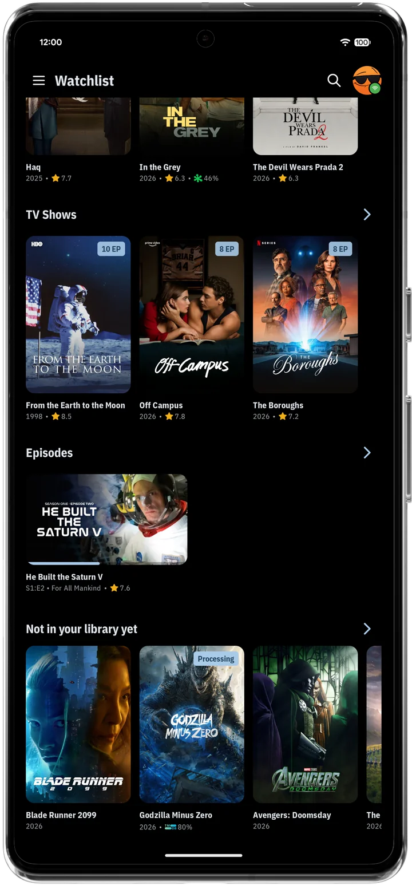
</p>

### Audiobooks and podcasts from Audiobookshelf

Browse your Audiobookshelf libraries by series and genre. Book pages show narrators, an author card, your listening stats and Audible ratings. The player has chapters, bookmarks, a sleep timer, skip silence, volume boost and an equalizer. Podcasts play continuously in the episode order you choose. Downloads work offline, and progress syncs back when you reconnect.

<p align="center">
  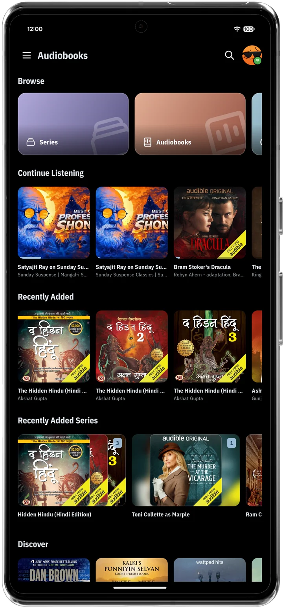
  &nbsp;
  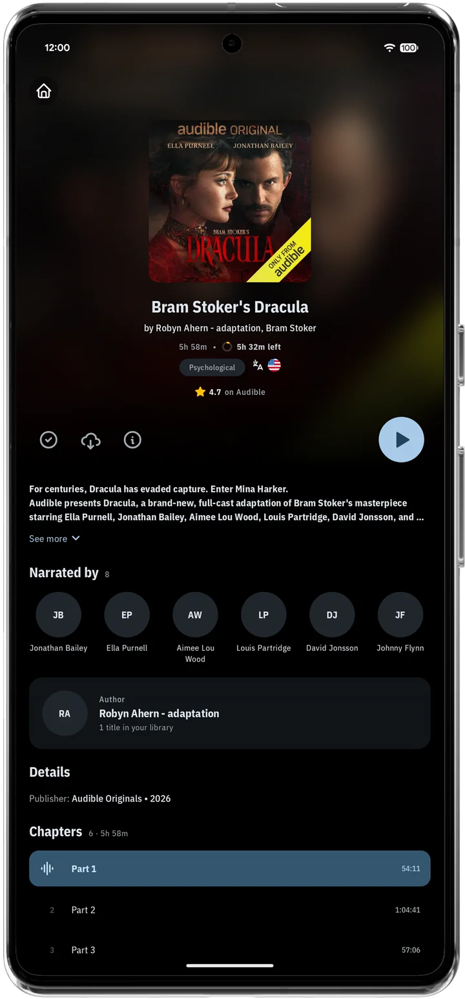
  &nbsp;
  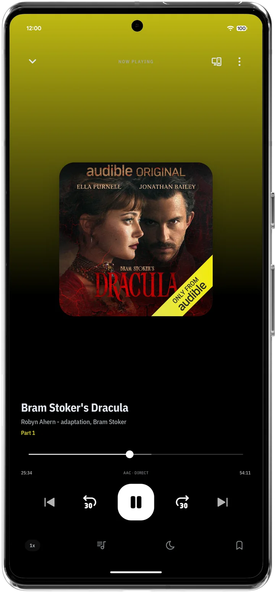
</p>

### Your server in your pocket

Admins get a Control Panel laid out like Jellyfin's dashboard. It covers:

- **Sessions:** see what's playing and whether it's transcoding, and remote-control any session.
- **Users and access:** permissions, parental controls and devices.
- **Libraries:** create them, change folders and options, and scan.
- **Server:** scheduled tasks, plugins, the activity log, a server log viewer, API keys, backups and server settings.

On any item you can also:

- Edit metadata and images, and Identify the item.
- Refresh metadata, or delete the item.
- Manage collections, people, music and lyrics.

<p align="center">
  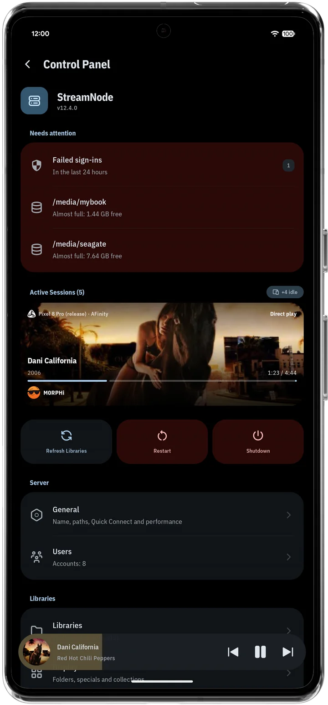
  &nbsp;
  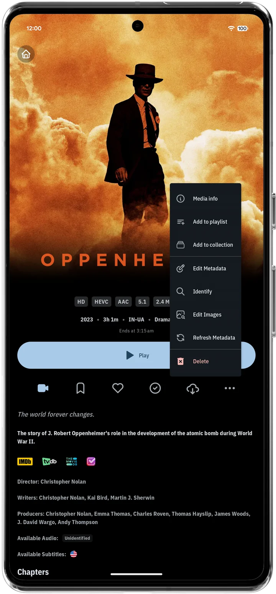
  &nbsp;
  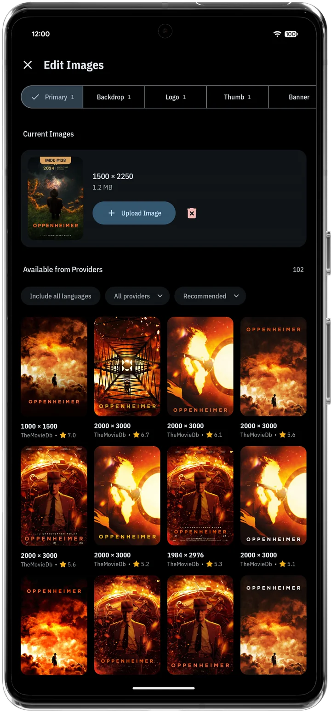
</p>

### Live TV and recordings

Live TV includes:

- A TV guide with day picker, filters and colour-coded categories.
- Channel and programme pages.
- One-off and series recordings, with series options, padding and keep limits.

<p align="center">
  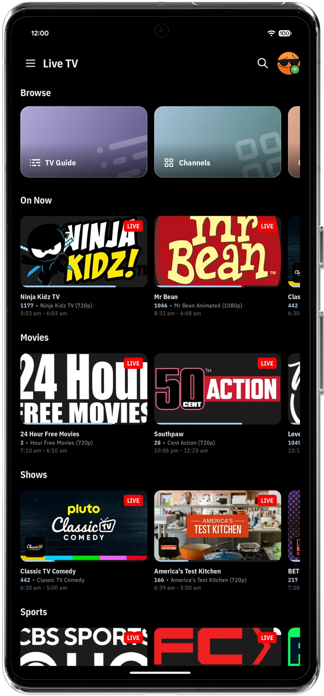
  &nbsp;
  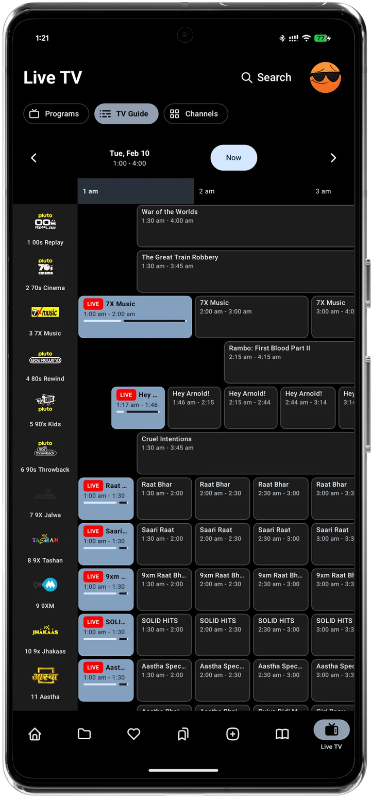
  &nbsp;
  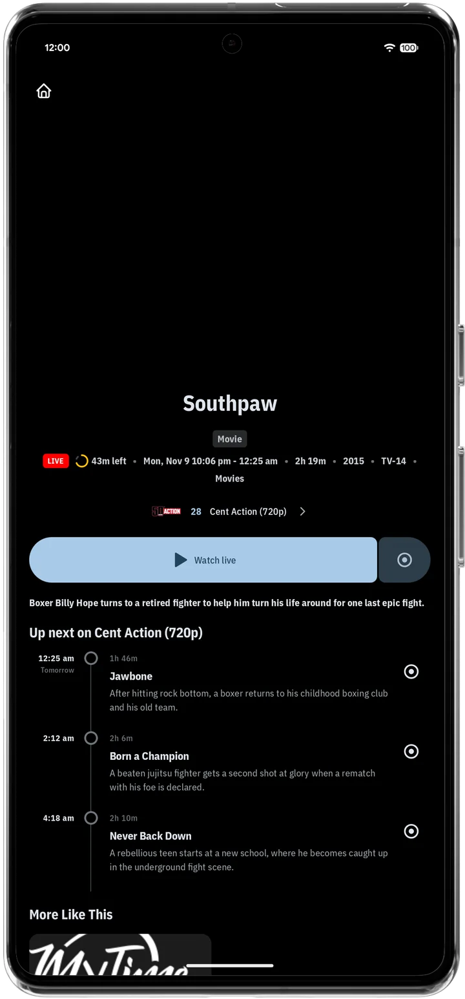
</p>

### Offline when you need it

Download movies, episodes, whole series, collections, music and audiobooks. You can download the original file or a transcoded copy at a lower quality. When there's no connection, AFinity switches to an offline home screen built from your downloads.

## Works with

All optional. Turn any of them on under **Settings > Connect Services**:

- **[Seerr](https://github.com/seerr-team/seerr):** requests, Discover and a synced watchlist
- **[Audiobookshelf](https://github.com/advplyr/audiobookshelf):** audiobooks and podcasts
- **[MDBList](https://mdblist.com/)** *(free key)*: IMDb, Rotten Tomatoes, Metacritic and Letterboxd ratings
- **[TMDB](https://www.themoviedb.org/)** *(free key)*: critic reviews, Where to Watch, Not in your library
- **[OMDb](https://www.omdbapi.com/)** *(free key)*: awards summary
- **[Last.fm](https://www.last.fm/api)** *(free key)*: popular tracks
- **[Wikidata](https://www.wikidata.org/):** award history, Universes & Sagas
- **[TheSubtitleDB](https://thesubtitledb.org/):** online subtitle search

AFinity also uses these Jellyfin features when your server has them: media segments, trickplay, subtitle and lyrics plugins, SyncPlay and Live TV recording.

AFinity's watchlist follows the one [KefinTweaks](https://github.com/ranaldsgift/KefinTweaks) introduced: it uses the same Jellyfin "Likes" flag, so if KefinTweaks is installed, your watchlist is the same in AFinity and the Jellyfin web app.

**Libraries:** movies, shows, music, Live TV, collections, playlists, mixed movie & show libraries, plus audiobooks and podcasts through Audiobookshelf. *Not yet:* home videos & photos, books, music videos.

## All features

Tap a section to expand it.

### Watch

<details>
<summary><b>Video playback</b></summary>

- Two switchable backends: LibMPV and ExoPlayer (with FFmpeg audio decoder)
- MPV with Vulkan and HDR passthrough after a per-device compatibility check (experimental)
- MPV options for hardware decoding, video and audio output, GPU API, tone mapping and HDR peak detection; in-app `mpv.conf` and `input.conf` editors
- Streaming quality with separate Wi-Fi and mobile limits, changeable mid-video, with the transcode reason shown
- Multiple audio, subtitle and version selection with language flags; preferred languages, optionally following your server settings
- Trickplay previews matched to the version you're playing
- Chapters with a chapter switcher and chapter-skip gesture
- Skip intros, outros, recaps, previews and commercials: off, button or auto-skip, with countdown, cancel and undo
- Custom seek steps (5-30 s), double-tap ripple, gesture controls for brightness, volume, seek and speed-up
- Keyboard shortcuts matching YouTube's web player
- Sleep timer with presets or End of item, fade out and extend
- Picture-in-picture with seek buttons, controls lock, zoom modes, playback speed and a stats overlay
- Configurable pause screen with details, ratings and cast
- Episode switcher and next-episode card
- SyncPlay watch groups
- Can be remote-controlled from other Jellyfin apps: play, pause, seek, volume and messages
- Media info sheet: container, codecs, HDR and Dolby Vision details, streams, and file path for admins

</details>

<details>
<summary><b>Subtitles</b></summary>

- Native ASS/SSA rendering with libass
- Online search from the player through server subtitle plugins and TheSubtitleDB
- Saved to the server when your account allows it, otherwise to the device; downloads keep theirs offline
- Labels for On your server, On this device and May be out of sync
- SDH preference and full styling: colour, size, position, alignment, outline, shadow, background, bold

</details>

<details>
<summary><b>Casting</b></summary>

- Chromecast with AFinity's own remote for video, music and audiobooks
- Audio, subtitle and quality choice, chapters, episode switching, 0.5x-2x speed
- HEVC and maximum bitrate options

</details>

<details>
<summary><b>Live TV</b></summary>

- Browse: TV Guide, Channels, Recordings, On Now, Shows, Movies, News, Sports
- Guide with day picker, sorting, favourites, categories and indicators (HD, Live, New, Premiere, Repeat)
- Programme and channel pages; long-press a channel to play it
- Record programmes or whole series with series options and padding
- Channel favourites, IPTV direct stream

</details>

### Listen

<details>
<summary><b>Music</b></summary>

- Browse by album, album artist, artist, genre and playlist with filters and saved sorting
- Synced and word-by-word karaoke lyrics; plain lyrics shown as text
- Popular tracks by Last.fm listeners, or by your own play count
- Radio, Instant Mix, queue management, normalization gain, equalizer and sleep timer
- More from this artist, More like this, MusicBrainz and AudioDB links
- Playlists: create and add from anywhere
- Home screen widget with Continue listening, per-widget styling, and cast control
- Resume from the widget, Bluetooth headphones and Android's media resume card

</details>

<details>
<summary><b>Audiobookshelf</b></summary>

- Home, Series and Libraries tabs, plus genre browsing
- Book pages with narrators, an author card, More by and Narrated by rows
- Chapters, bookmarks, sleep timer (including end of chapter), speed, skip silence, volume boost, equalizer
- Continuous podcast playback in your chosen episode order, with an Up Next card
- Listening stats, Audible ratings from your regional store
- Downloads and offline progress sync
- Shared mini player and widget with music

</details>

### Discover

<details>
<summary><b>Home screen</b></summary>

- Reorder, hide and add rows; custom rows from a source with extra filters; seasonal rows
- Universes & Sagas, All-Time Greats, Legendary Series, Popular Right Now, What Everyone's Bingeing
- Watch Again, Because You Liked, highest rated, popular studios, box set highlights
- Spotlight carousel: Random, Recommended, Recently added, Collection or playlist, or Custom filter; Full-bleed, Peek or Inset style
- Merge Continue Watching and Next Up, with a Next Up age limit
- View All for every row; export, import, backup and restore of layout and settings

</details>

<details>
<summary><b>Discovery & detail pages</b></summary>

- Classic or Modern detail page layout
- Ratings from IMDb, Rotten Tomatoes, Metacritic, Letterboxd and TMDB; critic reviews; Wikidata and OMDb awards
- Where to Watch in your region
- Starring..., More in..., similar items, special features, additional parts and collection membership
- Not in your library rows for collections and people
- Theme music on detail pages from your server's theme songs (Themerr and similar plugins): crossfades between titles, volume control, Wi-Fi only by default; off unless you turn it on
- Play, shuffle and download whole collections
- Unified search across Jellyfin, Seerr and Audiobookshelf with type filters and library scoping
- Genre, studio, network and collection browsing; full filmographies
- Favourites, watchlist and a random picker

</details>

<details>
<summary><b>Seerr</b></summary>

- Discover trending, popular, upcoming, genre, studio and network lists in your Seerr language
- Request movies and shows, 4K and specials, with service, quality profile and root folder choices
- Request on behalf of another user, with their quota
- Approve, decline, edit and delete requests; live status everywhere in the app
- Seerr watchlist with two-way sync, and a Not in your library yet row on the Watchlist tab
- Sign in with Jellyfin, a local account or Quick Connect

</details>

### Offline

<details>
<summary><b>Downloads & offline</b></summary>

- Movies, episodes, seasons, series, collections, music and audiobooks
- Original or transcoded quality, with audio track choice and subtitle burn-in
- Poster grid by show, album and podcast, multi-select delete and a storage breakdown
- Wi-Fi-only downloads, automatic offline mode and an offline home screen
- Granular cache controls

</details>

### Manage

<details>
<summary><b>Server admin (Control Panel)</b></summary>

- Overview: pending restart, failed sign-ins, full disks, plugin problems
- Server storage and library stats
- Sessions with transcoding status and full remote control
- Users: create, rename, password, disable, delete, avatar, permissions, parental controls, sign-in hours
- Libraries: create, folders, options, images, scan
- Devices: rename and sign out
- Scheduled tasks with triggers and time limits
- Plugins: install, update, enable, disable, uninstall, repositories
- Activity log, server log viewer, API keys, backups
- General, Metadata, NFO, Display, Playback, Trickplay and Transcoding settings

</details>

<details>
<summary><b>Item admin</b></summary>

- Edit Metadata for every item type, including sort title, external IDs and field locks
- Edit Images per image type with provider filters, previews and backdrop reordering
- Identify movies, series, collections, albums (MusicBrainz) and people
- Refresh metadata, including trickplay images
- Delete with a clear summary of what goes
- Add to and remove from collections; edit people; edit and search lyrics

</details>

### App

<details>
<summary><b>Interface & accounts</b></summary>

- Material 3 with dark, light, system and AMOLED themes and dynamic colour
- Adaptive layouts for phones, tablets and foldables; navigation bar, rail or drawer with your libraries
- Card sizes, app fonts, in-app language picker, RTL layouts
- Multiple servers and users with quick switching, one-tap sign-in and Quick Connect
- Server discovery on your network, several addresses per server with identity checks, and local, remote, Tailscale and offline indicators
- Live updates over WebSocket: watched, favourite and artwork changes show everywhere at once
- In-app updates, log viewer and crash reports

</details>

## Installation

<p align="center">
  <a href="https://github.com/MakD/AFinity/releases/latest"></a>&nbsp;<a href="https://apps.obtainium.imranr.dev/redirect?r=obtainium://app/%7B%22id%22%3A%22com.makd.afinity%22%2C%22url%22%3A%22https%3A%2F%2Fgithub.com%2FMakD%2FAFinity%22%2C%22author%22%3A%22MakD%22%2C%22name%22%3A%22AFinity%22%2C%22supportFixedAPKURL%22%3Afalse%7D"></a>
</p>

#### Build from source

```bash
git clone https://github.com/MakD/AFinity.git
cd AFinity
bash setup-git.sh
./gradlew assembleRelease
```

AFinity uses a custom `.afinityignore` file for Git ignore patterns. `setup-git.sh` configures Git to use these rules for this repository only. This setup is required once per clone.

> **Note:** Without a `key.properties` file in the project root, release builds are signed with the debug key. They install fine, but can't update an official release: uninstall the official APK first.

## Getting started

1. Open AFinity. Servers on your network appear automatically, or enter your server's address.
2. Sign in with your Jellyfin account or Quick Connect.
3. The **Connect Services** screen offers Seerr, Audiobookshelf, API keys (TMDB, MDBList, OMDb, Last.fm), Wikidata and TheSubtitleDB. All of them are optional, and you can come back to them anytime under **Settings > Connect Services**.

## Privacy

- **No tracking or analytics.**
- Your data stays on your device and your own servers.
- Outside services are used only after you turn them on, and each one receives only what it needs:
  - **MDBList, TMDB, OMDb and Last.fm:** the title's IDs or the artist's name, with your API key.
  - **Wikidata:** the IDs of the item you open, and of your library's movies and shows to group franchises.
  - **TheSubtitleDB:** the IMDb or TMDB ID, season and episode, and the language you pick.
- These lookups run without a setting, and none of them send anything about you:
  - **Audible ratings** on Audiobookshelf book pages: the book's ASIN goes to [Audnexus](https://audnex.us/).
  - **IMDb Top and trending rows:** public lists are downloaded from MDBList and Cinemeta and matched on your device.
- None of these services receive your Jellyfin address, account or watch history. Like any web request, they do see your IP address.
- Update checks are off until you turn them on.
- The source code is open for full transparency.

## Technical stack

<div align="center">


</div>

- **Language**: Kotlin
- **UI**: Jetpack Compose + Material 3
- **Architecture**: MVVM with repositories, Hilt
- **Playback**: LibMPV, Media3 ExoPlayer with FFmpeg audio decoder, libass
- **Networking**: Jellyfin SDK, Retrofit, OkHttp
- **Images**: Coil with BlurHash
- **Storage**: Room, DataStore, Tink for encrypted credentials

## Contributing

Contributions are welcome, whether you write code, design or translate.

### Help translate

AFinity is translated on **[Weblate](https://hosted.weblate.org/projects/afinity-yet-another-jellyfin-client/)**. Pick your language, or start a new one, and translate in your browser. Changes sync back to this repository automatically.

### Code contributions

Run `bash setup-git.sh` once after cloning, then:

1. **Fork** the repository
2. **Create** a feature branch (`git checkout -b feature/AmazingFeature`)
3. **Commit** your changes (`git commit -m 'Add some AmazingFeature'`)
4. **Push** to the branch (`git push origin feature/AmazingFeature`)
5. **Open** a Pull Request

```bash
./gradlew assembleDebug   # build a debug APK
./gradlew installDebug    # build and install on a connected device
./gradlew ktfmtCheck      # formatting check run by CI
```

## Project stats

<div align="center">


<p align="center">
  <a href="https://star-history.com/#MakD/AFinity&Date"><picture>
    <source media="(prefers-color-scheme: dark)" srcset="https://api.star-history.com/svg?repos=MakD/AFinity&type=Date&legend=top-left&theme=dark" />
    <source media="(prefers-color-scheme: light)" srcset="https://api.star-history.com/svg?repos=MakD/AFinity&type=Date&legend=top-left" />
    
  </picture></a>
  <a href="https://afinity-downloads.vercel.app/#MakD/AFinity&type=date&legend=top-left"><picture>
    <source media="(prefers-color-scheme: dark)" srcset="https://afinity-downloads.vercel.app/svg?repos=MakD/AFinity&type=date&theme=dark&legend=top-left" />
    <source media="(prefers-color-scheme: light)" srcset="https://afinity-downloads.vercel.app/svg?repos=MakD/AFinity&type=date&legend=top-left" />
    
  </picture></a>
</p>


&nbsp;


[](https://github.com/MakD/AFinity/issues)
[](https://github.com/MakD/AFinity/pulls)

</div>

[](https://hosted.weblate.org/engage/afinity-yet-another-jellyfin-client/)

## Acknowledgments

AFinity stands on the shoulders of giants. Special thanks to:

- [Jellyfin](https://jellyfin.org/): the open source media server that makes it all possible
- [MPV](https://mpv.io/) and [libmpv-android](https://github.com/jarnedemeulemeester/libmpv-android) by Jarne Demeulemeester
- [libass](https://github.com/libass/libass): subtitle rendering
- [Seerr](https://github.com/seerr-team/seerr): media discovery and requests
- [Audiobookshelf](https://github.com/advplyr/audiobookshelf): self-hosted audiobooks and podcasts
- [TMDB](https://www.themoviedb.org/), [MDBList](https://mdblist.com/), [OMDb](https://www.omdbapi.com/), [Wikidata](https://www.wikidata.org/), [Last.fm](https://www.last.fm/), [Audnexus](https://audnex.us/) and [TheSubtitleDB](https://thesubtitledb.org/): ratings, awards, popularity and subtitles

## Disclaimer

**AFinity does not support or condone piracy.** This application is designed solely for streaming media content that you personally own or have legal rights to access. AFinity includes no media content whatsoever. Any references, discussions, or support requests related to piracy or related tools are strictly prohibited and will be removed.

## License

This project is licensed under the **GPL-3.0 License**. See the [LICENSE](LICENSE.md) file for details.

## Support the project

AFinity is a personal project developed and maintained in my free time. If the app has improved your media experience, there are a few ways you can help:

### Community support

* **Star the project:** give us a ⭐ on GitHub. It helps others find the app.
* **Contribute:** bug reports and pull requests are always welcome.
* **Join the discussion:** share feedback or get help on our [Discord](https://discord.com/channels/1381737066366242896/1422939582533730325).

### Buy the developer a coffee

If you've spent hours enjoying your library through AFinity and want to show some appreciation, you can support my work here. It helps keep me fueled for those late-night coding sessions!

[](https://ko-fi.com/m0rph3us)
[](https://buymeacoffee.com/m0rphi)

*Every contribution, whether it's code, a bug report, or a coffee, helps make AFinity better.*

---

**Made with ❤️ for the Jellyfin community**

*AFinity is an independent project and is not affiliated with Jellyfin, Audiobookshelf, Seerr, TMDB, MDBList, OMDb, Wikidata, Last.fm, Audnexus or TheSubtitleDB.*  
*Jellyfin is a trademark of the Jellyfin project.*

---

**[Back to Top](#afinity---yet-another-jellyfin-client)**
